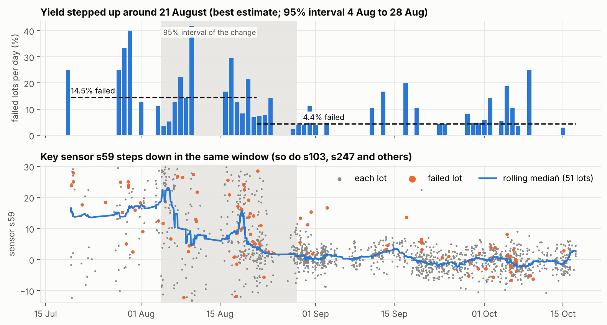
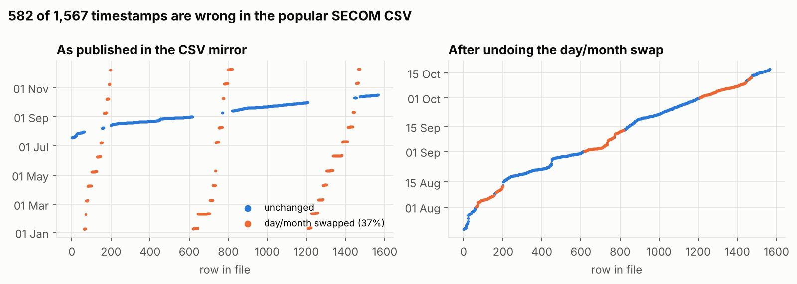
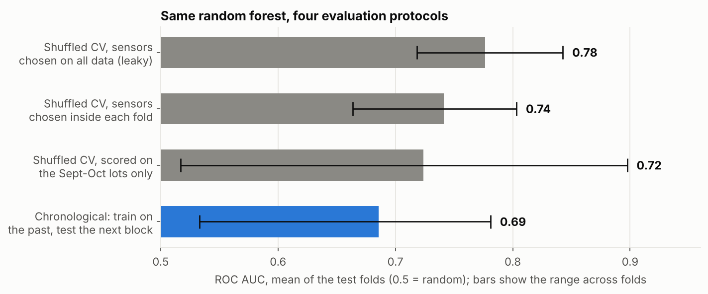
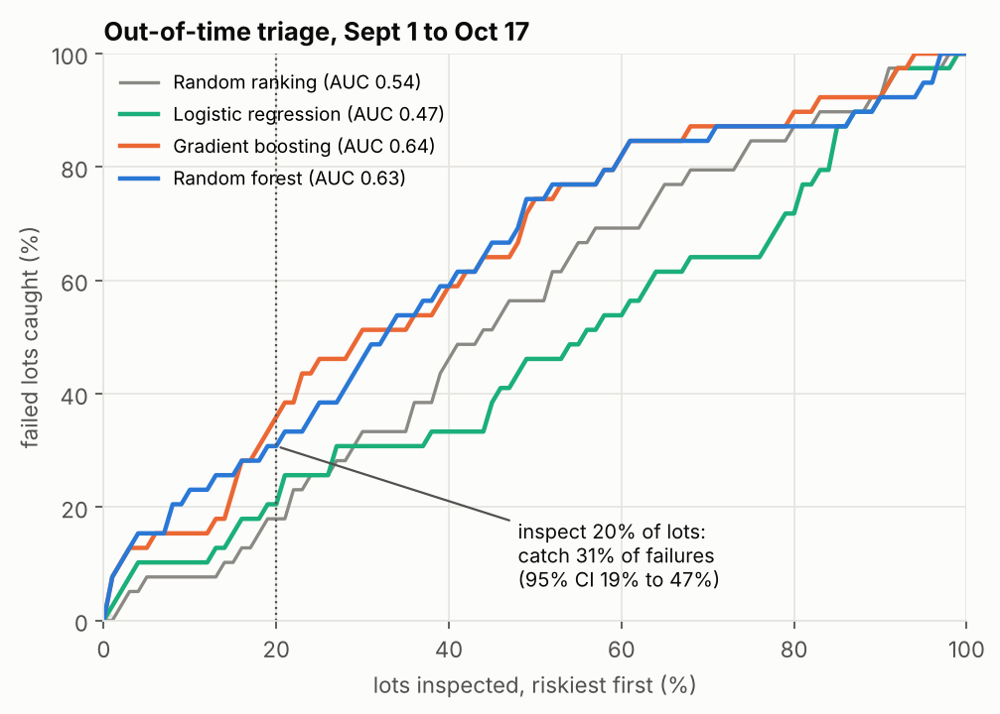
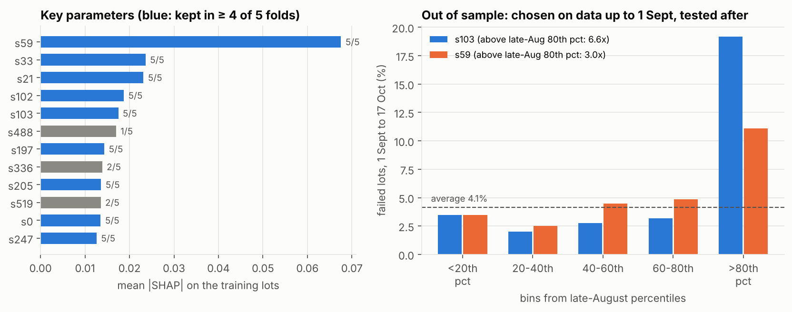
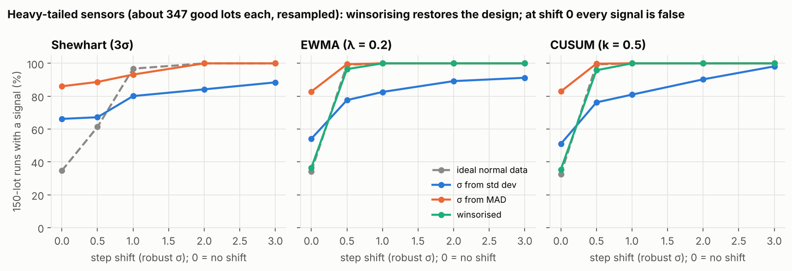
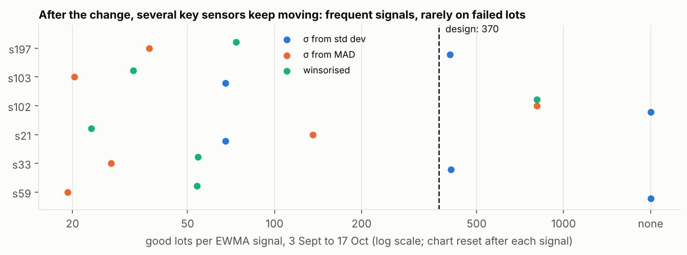
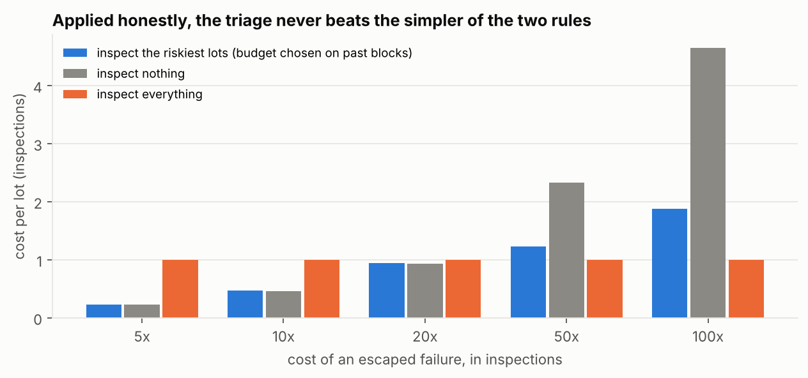
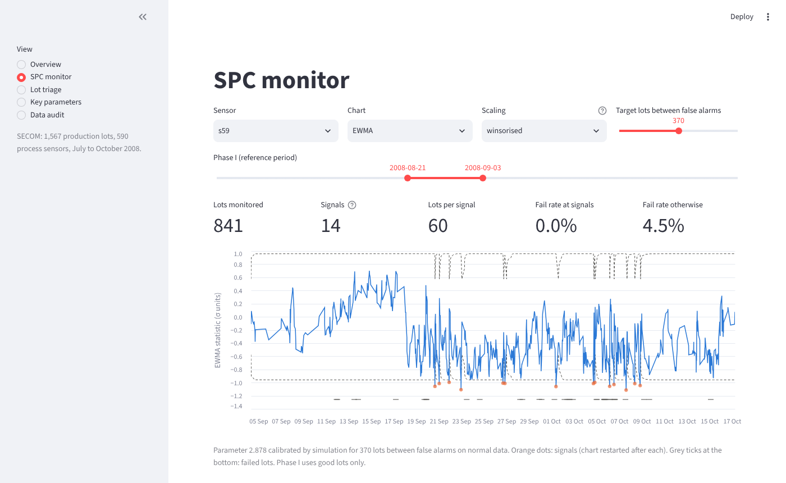

# Quality early warning on a real production line (SECOM)

[](https://github.com/Abderrahmane-BOULAMI/secom-early-warning/actions/workflows/tests.yml)

A quality-engineering study of **SECOM**, a real semiconductor production data set: 1,567 lots, 590 process sensors, and the final pass/fail result of each lot (104 failures).

The project combines three tools a quality engineer would use on a line:

- statistical process control (Shewhart, EWMA, CUSUM, Hotelling T²);
- a lot-risk model to decide which lots to inspect first;
- a root-cause analysis to find which process parameters move with the yield.

Every model is evaluated **out of time**: train on the past, test on the future, as the line would actually use it.



## Key findings

1. **The popular CSV copy of SECOM has wrong dates.** 582 of the 1,567 timestamps (37%) have their day and month swapped. Undoing the swap restores the file order and the documented period, 19 July to 17 October 2008. Any time-based analysis on the uncorrected file is wrong.

2. **Yield stepped up in August, and several sensors stepped with it.** The fail rate dropped from **14.5% to 4.4%** (best change point 21 August; 95% interval 4 to 28 August from a day-block bootstrap; block-permutation p ≈ 0.001, the smallest value 1,000 permutations can give). Sensors s103, s59 and s247 show sharp level shifts inside that window. Timing alone proves nothing here:
   - the interval is far too wide to say which change came first;
   - 9 of the 103 sensors with a strong shift fall within 3 days of the best estimate, close to the 7 expected by chance.

3. **One sensor clearly keeps predicting failures after the change, out of sample.** The first model saw data only up to 1 September and kept 50 sensors. Each was then tested on the following six weeks (941 lots it never saw, alert thresholds taken from late-August lots):
   - lots above the late-August 80th percentile of **s103** (73 of the 939 test lots with a value) failed **19.2%** of the time against 2.9% for the others (6.6x, Fisher p < 0.001, still significant after a Bonferroni correction for the 50 tests);
   - **s59**, the sensor that model ranked first, shows 11.1% above its threshold (63 lots) against 3.7% (3.0x, p = 0.012 as a single pre-specified test);
   - no other sensor survives the correction.

   s103 is the lead to hand to the process engineers, with s59 next.

4. **How a SECOM model is evaluated changes its score.** The same random forest, mean AUC of the test folds:

   | Protocol | AUC |
   |---|---|
   | shuffled CV, sensors chosen on the whole data set (a common leak) | 0.78 |
   | clean shuffled CV | 0.74 |
   | clean shuffled CV, scored on the Sept–Oct lots only | 0.72 |
   | train on the past, test the next block | 0.69 |

   The leak and the time order each cost about 0.04. The last number is the honest one, and even it varies from 0.53 to 0.78 from one block to the next.

5. **The lot-risk model is a weak triage tool, and does not pay for itself.** Out of time, inspecting the riskiest 10% of lots catches 23% of failures (2.3x random) and 20% catches 31% (CI 19% to 47%). When the inspection budget is chosen on past blocks and applied to the next one, the model never beats the simpler of two rules: inspect nothing, or inspect everything. With 39 failures in the test period, the gain is too small and too unstable.

6. **On real sensors, textbook SPC does not behave as designed, and winsorising fixes most of it.** The key sensors are heavy-tailed (excess kurtosis 7 to 260; for s33 the standard deviation is 6 times the robust σ). Resampling two weeks of good lots (346 to 348 per sensor), with charts set for one false alarm per 370 lots, and averaging over the six sensors:
   - with σ from the standard deviation, a 1 robust-σ shift is caught within 150 lots only 81 to 83% of the time by EWMA and CUSUM (100% in theory), and false alarms are still too frequent (51 to 66% of 150-lot runs, about a third in theory);
   - with σ from the MAD, everything is caught, but 83 to 86% of runs with no shift raise a false alarm;
   - **winsorising** (clipping at 3 robust σ before the chart) restores the design: 35 to 36% false-alarm runs, and 96 to 97% of 0.5 σ shifts caught (99% in theory).

   Real lots also drift. After the change, even winsorised EWMA charts signal every 23 to 74 good lots on five of the six sensors, against 370 by design. Failures at those signals are no more frequent than elsewhere (4 of 102 signals). Single-sensor SPC here tracks process movement, not yield.

7. **The multivariate chart gives a suggestive, rare signal.** A Hotelling T² on the six key sensors raises 8 alarms in six weeks (0.9% of lots). 2 of those 8 lots failed: 25% against 4.2% for the quiet lots (p ≈ 0.04 for that many failures by chance). Three caveats:
   - the six sensors were chosen with labels that overlap this period;
   - the chi² limit assumes normal data, and on these heavy-tailed sensors 3.4% of the Phase I good lots exceed it, against 0.27% by design;
   - it catches only 2 of the period's failures.

   It is a lead, not a proof.

## Results

| | |
|---|---|
|  |  |
|  |  |
|  |  |

Out-of-time benchmark, 1 Sept to 17 Oct, 5 chronological blocks, 941 lots, 39 failures, base rate 4.1%:

| Model | AUC, pooled (95% CI) | AUC, mean of blocks | Avg. precision | Caught at 10 / 20 / 30% inspected |
|---|---|---|---|---|
| Random forest | 0.63 (0.55 to 0.73) | 0.69 | 0.089 | 23 / 31 / 46% |
| Gradient boosting (LightGBM) | 0.64 (0.55 to 0.74) | 0.70 | 0.095 | 15 / 36 / 51% |
| Logistic regression | 0.47 | 0.49 | 0.051 | 10 / 21 / 31% |
| Random ranking | 0.54 | 0.59 | 0.047 | 8 / 18 / 33% |

How to read the table:

- **Pooled** figures rank each lot within its block, as if the inspection list were drawn up at the end of each block (a batch release). Ranking the raw probabilities across blocks instead, lot by lot, gives an AUC of 0.61 and 28% caught at 20% for the random forest.
- The **intervals** come from a bootstrap that resamples whole days.
- Gradient boosting and random forest are within noise of each other.



## Method

```
data audit -> leakage-safe pipeline -> chronological evaluation -> triage policy
           -> change points -> key parameters (out of sample) -> SPC in the new regime
```

- **Data** (`secomqc/data.py`): fixes the timestamp swap, refuses the file unless the corrected dates are in order and inside the documented span, sorts the lots in time, and reports the data quality: 116 constant sensors, 28 sensors more than half missing, 4.5% missing values.
- **Pipeline** (`secomqc/preprocessing.py`, `models.py`): drops constant, mostly missing and near-duplicate sensors, then keeps the 50 sensors that best separate failed from passed lots (Mann-Whitney test), imputes medians and classifies. Every step is fitted inside each training fold.
- **Evaluation** (`secomqc/evaluation.py`): expanding-window blocks from 1 September, bootstrap by days, and every protocol compared on the same footing.
- **Inspection policy** (`secomqc/cost.py`): the budget is chosen on past blocks and applied to the next one, and compared with the two simple rules.
- **Change points** (`secomqc/spc.py`): least-squares single mean shift, a p-value from permutations of whole days, and a location interval from a bootstrap of whole days within each segment. The coincidence of sensor shifts with the yield change is compared with chance.
- **Key parameters** (`secomqc/explain.py`; the test is in `experiments/run_all.py`): SHAP importance and selection stability across the 5 blocks, then the out-of-sample test of finding 3 on all 50 sensors of the first model, with a Bonferroni correction.
- **SPC** (`secomqc/spc.py`):
  - Shewhart individuals, EWMA with exact limits and two-sided tabular CUSUM, all restarted after each signal;
  - Hotelling T² on standardised sensors with the Phase I sample covariance;
  - a winsorised scaling for heavy-tailed sensors, evaluated by resampling the Phase I good lots;
  - EWMA and CUSUM limits calibrated by simulation to an in-control ARL of 370. The simulator reproduces published values (EWMA λ = 0.2, L = 2.962: ARL ≈ 500; CUSUM k = 0.5, h = 5: ARL ≈ 465).

## Run it

```bash
pip install -r requirements.txt
python experiments/run_all.py        # about 4 minutes, writes results/*.csv and *.json
python experiments/plot_results.py   # writes results/figures/*.png
pytest -q                            # 27 tests
streamlit run app/dashboard.py       # interactive dashboard
```

The dashboard has five views:

- **Overview**: daily fail rate and the yield change.
- **SPC monitor**: any sensor, chart and scaling, with an adjustable Phase I and false-alarm target.
- **Lot triage**: inspection budget and cost sliders, and the lots to inspect.
- **Key parameters**: importance table and fail rate by value of each sensor.
- **Data audit**: the timestamp fix and data-quality figures.



## Tests

The 27 tests cover:

- the timestamp fix and the audit figures against the UCI documentation;
- that sensor selection only ever sees training lots, and that folds never look ahead;
- the run lengths against published SPC tables, and the EWMA and CUSUM statistics computed by hand;
- chart restarts, a Hotelling T² on sensors whose scales differ by more than 10⁸ and on correlated sensors, and the winsorised scaling;
- the empirical limit calibration and the change-point test and interval;
- the timing of the yield change.

## Limitations

- Sensor names are anonymised, so findings point to *which* signal to investigate, not to a physical cause. The associations are correlations.
- 104 failures over three months is a small sample. Results vary a lot from block to block, which is why ranges and intervals are shown.
- The six SPC sensors were chosen with labels up to 6 October, which overlaps the SPC monitoring period. The SPC results describe the behaviour of the charts, not a prospective test.
- SECOM gives no specification limits, so process capability (Cp, Cpk) cannot be computed.

## Data

McCann, M. and Johnston, A. (2008). *SECOM* [data set]. UCI Machine Learning Repository, CC BY 4.0. The CSV in `data/` is the widely used mirror of that release, with the timestamp problem described above (corrected at load time, file left untouched).

## Authors

Abderrahmane BOULAMI and Kawtar BELLAMINE, Arts et Métiers ParisTech.
